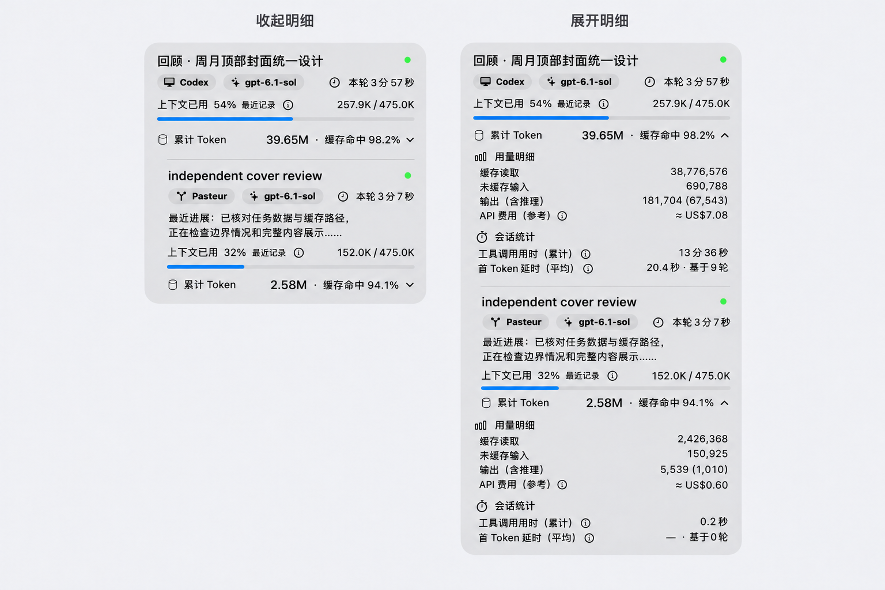

# 任务卡片紧凑布局方案

状态：用户已于 2026-11-06 整体确认，包含第 4 项间距调整，并明确要求实施。当前源码已形成实现候选，作者自动检查与测量完成，结果及人工验收缺口见[验证记录](compact-layout-validation.md)；静态设计稿 r02 保留为概念参考，不代表原生视觉验收结果。

本方案在[现行信息层级](README.md)上精简重复信息和留白。采用一个已确认方向，现补充收起与展开状态的同组任务静态设计稿。换行、实际高度和原生材质由实施后的固定夹具及真实菜单验证。

## 实施定稿

用户在讨论虚线框后确认采用“图标＋加重标题＋留白”，并明确提交完整实施计划。用量明细与会话统计的标题从 11pt medium 调整为 11pt semibold，保留图标，不新增边框或分区背景。以下四项紧凑调整、每层 10pt 的整行缩进和既有数据语义继续有效。无需重复确认已接受方案。

## 静态设计稿 r02



1536 × 1024 PNG，内置图像工具生成；左侧父子任务均收起，右侧同组任务均展开。数字为沿用参考截图的展示样例，进展为示例文案，不代表新读取的账号数据。顶部额度区不属于本轮视觉范围。

四项调整均已表达：无独立路径行；进展标签与正文共两行；用量明细与会话统计之间无横线；留白更紧凑。父子任务之间的线及子任务身份缩进保留。r01 的身份区缩进不明显，r02 已做一次针对性修订。

图像仍有局部精度限制：展开子任务的数据子组左缘未与其身份区完全一致。实施须遵守本方案的整行 10pt 子任务缩进，不能照图保留这一偏差。图像也不保证 8pt 的像素精度、原生字体度量、悬停或辅助功能行为。方案的文字与尺寸约束优先于生成图。

## 目标与范围

用户于 2026-11-06 提出：移除子任务独立路径行；将“最近进展”标签与正文合并为最多两行；移除展开明细内的统计分区分隔线；检查其他可精简处。

适用于全部任务行，包括主任务、一层及多层子任务、状态待确认任务。父任务占位行不增加新内容。既有 360pt 面板、字体、卡片圆角、父子缩进、来源与模型徽章、运行状态及本轮计时保留。数据读取、统计口径、费用计算、刷新与任务控制不在本轮范围。

## 推荐方案

| 项目 | 当前结构 | 提议结构 |
|---|---|---|
| 子任务路径 | 标题下另占一行 `/root/…` | 删除独立路径行；主任务若有 `/root` 也不单列 |
| 进展与操作 | 标签一行，正文最多两行 | `最近进展：正文` 或 `最近操作：正文`，整个段落最多两行 |
| 统计分区 | 用量明细与会话统计之间有横线 | 移除该横线及其占位，保留两个分区标题和图标 |
| 纵向间距 | 任务行基础间距 8pt，部分节点另加 4pt；展开区间距 10pt | 移除上下文、累计 Token、展开区前额外 4pt；任务行及展开区相邻块间距统一 8pt，数据子组内 6pt 保留 |

### 路径与任务识别

- 路径不在收起态、展开态或额外详情行中重新出现。
- `agentPath` 数据仍保留，空标题按现有顺序使用路径末段等信息回退，不修改记录或任务 ID。
- 有路径时，标题悬停显示完整标题与完整路径；无路径时仍只显示完整标题。辅助功能以标题为标签、路径为补充描述，不再新增独立路径节点。
- 同名子任务仍由父子缩进、昵称徽章及悬停路径区分，不引入新徽章或编号。

### 两行进展

```text
最近进展：已核对两项数据源，正在检查较长
进展文本的换行与截断……
```

- 标签和正文构成同一自然换行段落；第二行从段落左边缘开始，不使用固定标签列。
- 标签沿用 11pt 中等字重，正文沿用 11pt 常规字重与次级颜色。
- 最多两行，短内容仅占一行；无进展时不保留占位。
- 超出两行时尾部截断。悬停及辅助功能提供完整标签与正文，辅助功能只朗读一次。
- 保留消息与工具操作的语义区别，不将“最近操作”改称“最近进展”。换行规则同时覆盖中文、英文、混排和无空格长文本。
- 冒号、空格及标签组合按当前语言本地化，避免中文标点固定用于英文。

### 展开区与家族边界

展开区按“可选角色 → 用量明细 → 数据行 → API 费用 → 会话统计 → 数据行”排列。费用与会话统计之间只用 8pt 留白连接，不插入空行、透明分隔组件或补偿性 padding。

分区标题为 11pt semibold，不使用虚线框或额外背景。正文、图标、数据和点击区域尺寸沿用既有值。

父子任务及兄弟任务之间的现有分隔线保留。移除路径后，这些线仍承担任务边界识别。所有任务仍共用家族卡片，不增加嵌套背景。

唯一展开入口、各任务独立展开状态、键盘操作、完整数值悬停、说明按钮和浮层生命周期保留。上下文占用继续在累计 Token 上方常驻，“最近记录”提示保留，避免将历史记录误读为实时值。

## 取舍与其他观察

保留当前布局的优点是无需重验，但无法减少独立路径和标签占行；仅移除路径与统计横线改动最少，但进展仍可能占三行。推荐同时实施以上四项：保留数据及字号，减少独立行和重复留白。代价是正文可见字符会因行内标签而略少，完整内容仍可通过悬停和辅助功能获取。

不建议继续删除分区标题或父子分隔线。两者有不同的识别职责。也不建议缩小字体、缩小点击区域或增加新的折叠层级。

用户截图中首张卡片标题为 `# Files mentioned by the user:`。这可能来自上游标题，也可能来自本地标题回退；截图不足以判断。建议单独核查来源，暂不纳入本轮布局或加入未经证实的过滤规则。

## 实施与审查安排

1. 在 `Veyra/App/MonitorPanel.swift` 调整 `TaskIdentityHeader`、`TaskProgressSection`、`TaskRow` 和 `TaskTokenDetails`。保留 `TaskGroupCard` 的家族分隔线。实现由单一执行者负责，避免同一视图文件并发写入。
2. 复用 `Veyra/App/PreviewSupport.swift` 的 tokenBreakdown、taskFamily、长标题与溢出场景，必要时补齐进展边界夹具。复用 `TaskDetailInteractionChecks` 和 `TaskInfoInteractionChecks`，仅添加有行为价值的检查；不为移除一条装饰线写镜像测试。
3. 若行内标签需要新本地化组合格式，同步 `Veyra/Resources/Localizable.xcstrings`。不调整数据解析或统计生命周期。
4. 实施后更新现行设计和使用指南中受影响的描述。历史概念图及历史验收结论保留其时间边界。
5. 审查核对面板装配到任务家族、任务行、展开详情和说明浮层的实际路径；检查无路径、无进展、长文本、深层子任务、未知数据及刷新后展开状态。普通 design 调用不启动其他 agent；后续单独 review 可审查固定候选，若用户调用 closeout，则按该入口安排独立 reviewer。

原实现者负责整改，原 reviewer 优先复查。若实施触及任务 ID、读历史的触发条件、统计语义、父子归属或说明焦点恢复，须扩大对应回归范围并重新核对设计，不能以本提案授权这些变化。

## 验收计划

下表为直接从 design 起步形成的验收提议；本轮没有补造 need 阶段或运行结果。

| 条件 | 验证与证据 |
|---|---|
| AC-1 无独立路径行，标题回退和识别信息可用 | 一层/多层及同名子任务夹具；核对标题悬停与辅助功能描述；读取层与 TaskText 回归 |
| AC-2 进展与操作整段不超过两行，短内容一行，无内容不占位 | 中英文、混排、长无空格文本及源文本带换行夹具；核对完整悬停和单次辅助功能朗读 |
| AC-3 展开统计内部无分隔线，家族边界线仍存在 | 父子分别收起、分别展开和同时展开的固定夹具及真实菜单截图 |
| AC-4 卡片更低且可读性不退化 | 同一候选前后、同一夹具及环境记录 contentHeight；有路径及长进展的目标卡片应降低，无路径无进展卡片不应变高；不设未经实测的节省像素值 |
| AC-5 窄面板和长数据保持正常 | 360pt 宽度、长标题/徽章/数值、深层缩进、溢出滚动；保留必要换行，不缩字号、不横向裁切 |
| AC-6 展开、刷新及说明交互正常 | 父子独立展开/收起、刷新保留状态、收起恢复高度；Space/Return、浮层 Escape 和焦点恢复检查 |
| AC-7 原生外观及读屏信息正常 | 浅色/深色、降低透明度、增强对比度及溢出滚动；辅助功能树核对与 VoiceOver 人工抽查分别记录 |

实施阶段按仓库固定入口运行：

```sh
/usr/bin/python3 -I -B /Users/zhubowen/Documents/yuzio-ai/veyra/scripts/verify_local.py test
/usr/bin/python3 -I -B /Users/zhubowen/Documents/yuzio-ai/veyra/scripts/verify_local.py previews menu --language both
/usr/bin/python3 -I -B /Users/zhubowen/Documents/yuzio-ai/veyra/scripts/verify_local.py release-build
```

实施与自动验证已由用户的完整实施请求授权，实际结果记录于本轮 code 交接及验证记录。构建和测试按仓库规则使用非沙箱执行；布局位图不证明原生材质或 VoiceOver 操作通过。真实 app launch、外部 AX 读取遵守独立授权边界，不折入预览命令；本轮不自动提交或发布。

## 确认与停止条件

用户原始第 1～3 项为有效目标。用户于 2026-11-06 明确回复“确认这个方案，包括第 4 项间距调整，生成一份设计稿看看效果”，认可前轮完整汇总，包含路径的悬停补充、操作标签同步、8pt 间距及验证安排。本轮补充静态图，没有改变已确认方案，不重复索取同一整体确认。实际高度和原生可读性尚未验证。

design 方案已确认并补充静态稿，随后用户明确要求按完整计划实施；当前允许 code 范围内实现和检查。若用户更改标签行数、分隔线范围、信息保留范围或间距方向，先更新完整汇总再确认。若原生检查显示识别混淆或文本截断异常，停止收尾并整改，不凭静态稿宣称通过。
